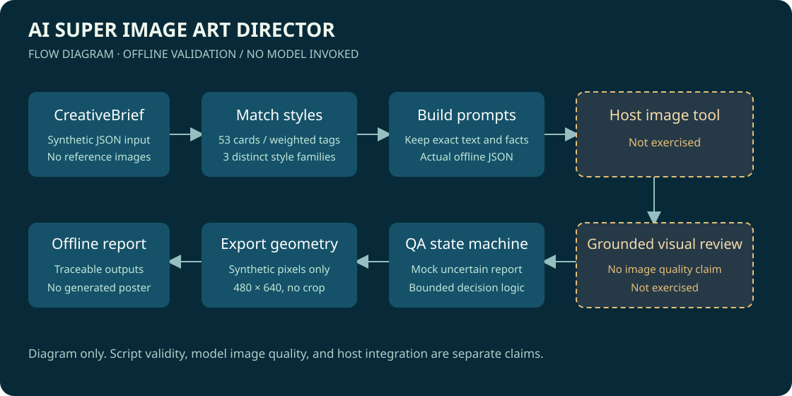
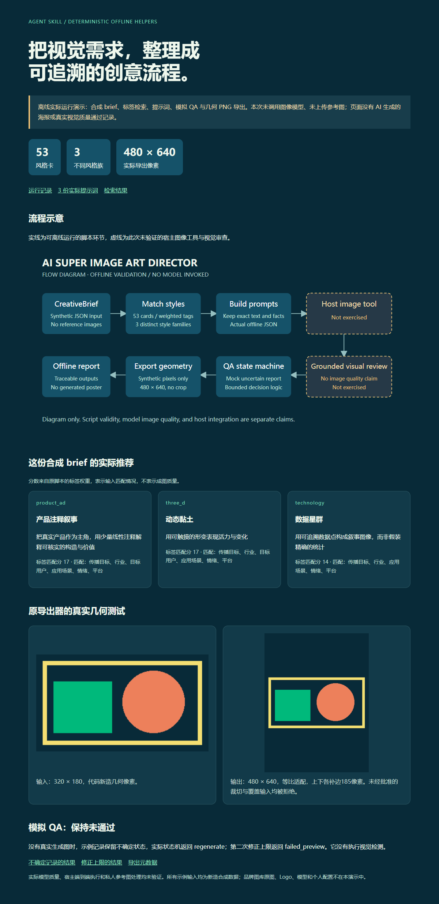

# AI Super Image Art Director

面向海报、产品广告、校园活动与品牌视觉的 **Agent Skill 和离线辅助工具**。它把一句需求整理成结构化 brief，按标签权重推荐有区别的视觉方向，生成可追溯的提示词，再根据审查记录决定通过、修改、重做或保留失败预览。

原项目的 22 个源码、知识库、宿主元数据和测试文件完整保留。现有目录包含 **53 张风格卡、20 个行业档案、8 类应用指导、10 个来源案例和 9 个图库机制摘记**。这些数量描述整理范围，不代表生成成功率。



**本仓库不是图像模型 API 客户端。** Python 脚本可以离线运行；真正生图需要支持该 Skill 的宿主提供图像工具。此次没有调用模型、上传参考图或验证真实生图质量。下方图片是几何测试输入经过原导出器处理的真实结果，不是 AI 海报样例。



## 快速运行离线示例

需要 Python 3.10+；本机实测为 Python 3.12、Pillow 11.0.0。下载或克隆仓库，在项目根目录运行：

```powershell
python -m venv .venv
.venv\Scripts\python -m pip install -r requirements-tested.txt
.venv\Scripts\python examples/run_offline_demo.py --output .runtime/my-first-demo
```

macOS/Linux 可把 `.venv\Scripts\python` 换成 `.venv/bin/python`，这两个平台尚未实测。输出目录需为空。示例会实际执行原脚本，产生风格排序、3 份提示词、两个模拟 QA 决策及 480×640 PNG，并核对未获批准的裁切和输入覆盖被拒绝。它只创建几何像素，参考图列表为空。

- [本次实际输出记录](examples/offline-demo/validation.json)
- [实际推荐方向](examples/offline-demo/matched-styles.json)
- [实际提示词包](examples/offline-demo/prompt-packages.json)
- [本地静态演示](docs/index.html)：可直接打开；Pages 部署后也可浏览同一离线报告。

模拟 QA 的结果是 `regenerate` 和达到两次修正上限后的 `failed_preview`。这是对输入记录的状态机验证，**没有进行像素审查，也没有把测试图判成合格海报**。

## 安装为 Skill

将包含 `SKILL.md` 的完整仓库目录通过宿主的本地 Skill 安装入口导入。手动安装时，可把该目录放入宿主用户技能目录，例如 Codex 的用户技能目录下 `ai-super-image-art-director`。保留 `scripts/`、`style_library/`、`knowledge/`、`references/` 和 `agents/` 的相对结构；已有同名安装先做版本对照。

在支持 Skill 和图像工具的会话中，可以用 `$ai-super-image-art-director`，附上受众、用途、必须出现的文字、图片数量和限制。脚本辅助准备提示词，宿主负责实际调用图像工具并检查输出。本轮只验证安装结构、离线命令与数据约定，未做真实宿主会话或模型端到端测试。无需为离线脚本提供账号、环境变量文件或模型密钥。

## 原有命令

```powershell
python scripts/validate_catalog.py
python scripts/match_styles.py --brief tests/fixtures/recruitment_brief.json --top-k 3
python scripts/build_prompt.py --brief tests/fixtures/drone_brief.json --style-id data_constellation
python scripts/qa_state.py --report examples/offline-demo/qa-uncertain-input.json
python scripts/export_image.py --input examples/offline-demo/synthetic-input.png --output .runtime/export.png --width 480 --height 640
python -m unittest discover -s tests -v
```

`match_styles.py` 是确定性的标签检索和风格族去重，不使用向量模型。`qa_state.py` 检查九项硬性审查记录和五项评分，无法自行识别手指、文字或无人机部件。`export_image.py` 默认等比适配并补边；裁切需要显式 `--crop-approved`，导出像素正确不代表设计或内容合格。

## 结构与验证

```text
SKILL.md                   # 宿主编排规则
scripts/                   # 检索、提示词、QA 状态、图片导出和目录校验
style_library/             # 48 基础风格及 5 个有来源的原创改编
knowledge/                 # 行业、场景、案例、观察与领域检查
references/                # 输入约定和视觉审查要求
agents/openai.yaml         # 可公开的宿主界面元数据
tests/                     # 原有 10 项行为测试及虚构 brief
examples/                  # 可重跑离线示例及真实结果
docs/                      # 明确标注的流程示意和离线报告页面
third_party/               # 参考图库原许可
```

`examples/offline-demo/` 和 `docs/` 保存明示合成的实际结果与公开展示产物；`.runtime/`、依赖缓存、账号配置和临时构建目录不入库。[几何 PNG 导出结果](docs/synthetic-export.png)可单独查看。

原有 10 项测试通过；另实际跑通目录校验、三方向检索与提示词构建、模拟 QA 分支和几何 PNG 导出。没有下载图库原图、读取私人参考图、调用付费接口或运行模型。全新环境联网安装和 GitHub Actions/Pages 状态以实际运行结果为准，不能把本地通过写成远端已通过。

当前状态为可安装的 Skill 与可运行的离线工具归档。真实模型输出质量、所有平台图片格式及完整宿主编排仍需实际使用验证。

## 来源、许可与后续

本机开发任务有对应索引；三处原安装/备份树的 22 个文件逐一相同。其中用户技能入口是指向全局源目录的 Windows junction，不能当三个独立项目，也不应删除仍在使用的全局源。文件时间和先前归档哈希没有被当作版权证明。

自有代码、整理文字和本次示例按用户授权采用 [MIT](LICENSE)。图库机制摘记与五个改编保留 [freestylefly/awesome-gpt-image-2](https://github.com/freestylefly/awesome-gpt-image-2) 来源及[原 MIT 声明](third_party/awesome-gpt-image-2.LICENSE)。品牌案例只保留短事实摘要、观察与推断，原图、Logo、模型、网站代码和私人素材不在本仓库。详见[来源与依赖边界](NOTICE.md)。

后续可在有授权的真实案例中验证宿主生成、逐字审查和导出质量；知识卡更新需重新核对来源。现有来源日期保留原记录，本次没有声称逐页重审所有案例或验证营销效果。
